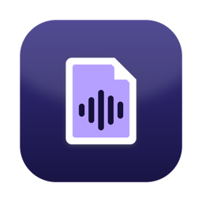
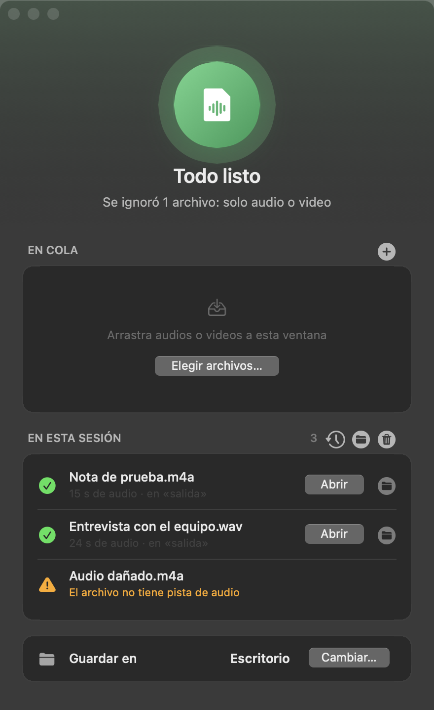
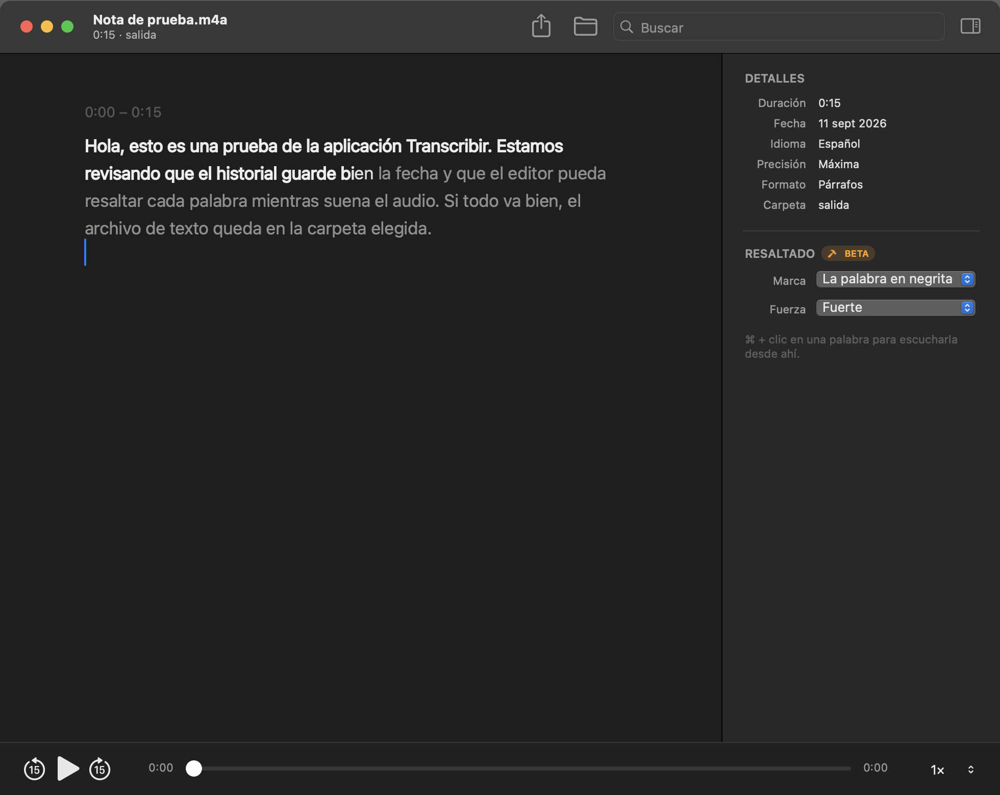
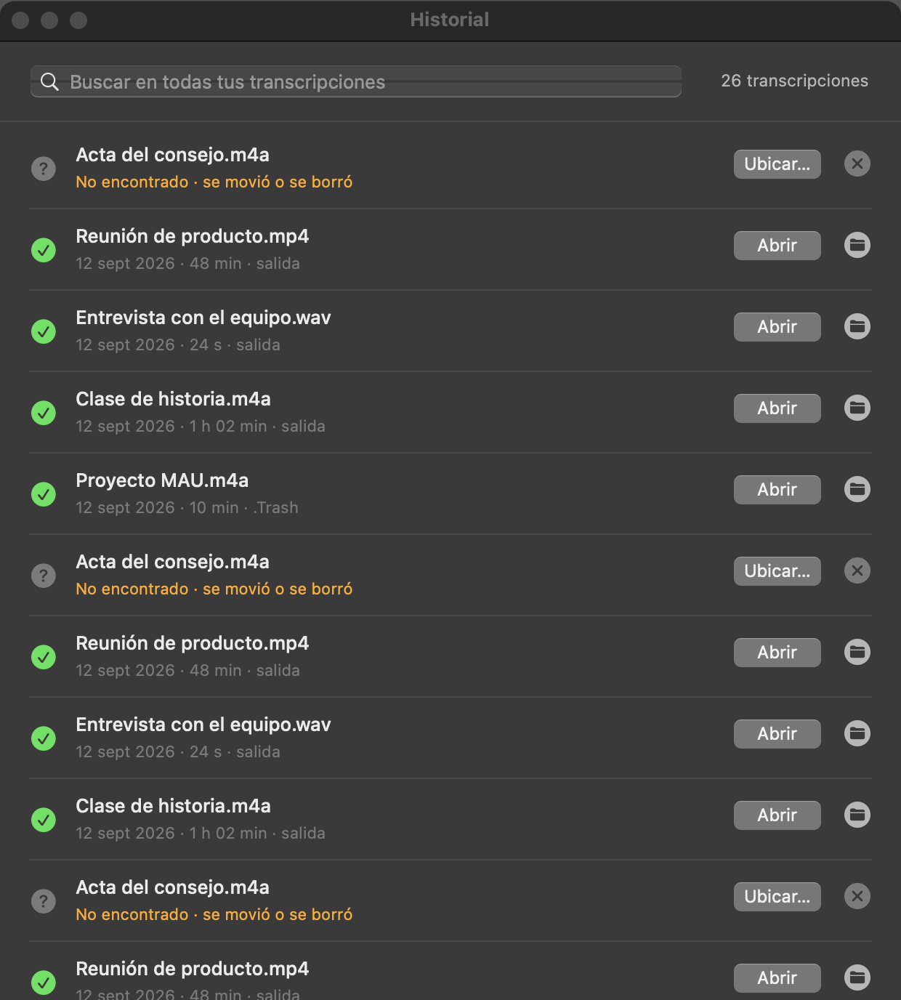
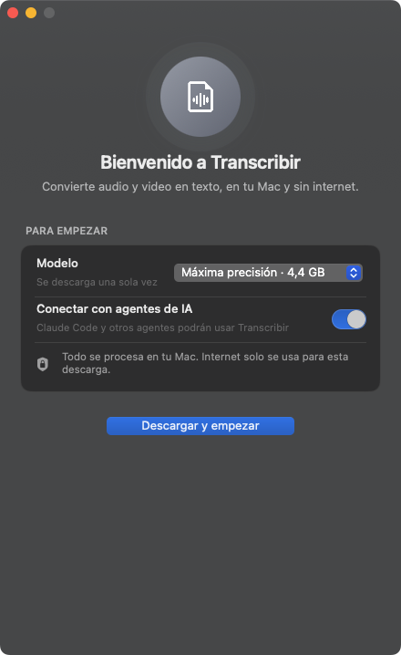
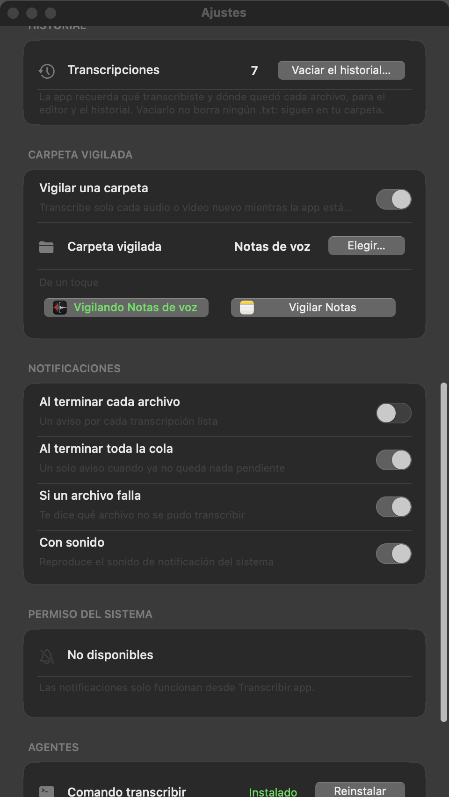

<div align="center">



# 🎙️ Transcribir

**Convierte audio y video en texto, en tu Mac y sin internet.**

Arrastra tus reuniones, clases, entrevistas o notas de voz: se encolan, se
transcriben con un modelo de código abierto en la GPU del chip de Apple y cada
una termina como un `.txt` limpio o como subtítulos `.srt`.

[](https://www.python.org/)
[](https://pyobjc.readthedocs.io/)
[](https://developer.apple.com/documentation/appkit)
[](https://github.com/ml-explore/mlx)
[](https://huggingface.co/Qwen/Qwen3-ASR-1.7B)
[](https://github.com/k2-fsa/sherpa-onnx)
[](https://developer.apple.com/documentation/avfoundation)
[](https://py2app.readthedocs.io/)
[](https://www.apple.com/macos/)
[](https://support.apple.com/en-us/116943)
[](#-para-agentes)
[](LICENSE)



</div>

---

## 🎧 El problema

Transcribir bien suele obligar a elegir entre dos males: subir tus audios a un
servicio en la nube, o conformarte con un modelo local lento y menos preciso.

Los modelos abiertos de 2026 ya compiten con los de pago, pero correrlos a mano
es otro asunto: entornos de Python, `ffmpeg`, descargas de varios gigas, y
ninguna forma cómoda de encolar diez archivos y olvidarte.

Transcribir empaqueta el mejor modelo abierto para español que corre bien en un
Mac en una app nativa que se usa arrastrando archivos. En pruebas públicas,
**Qwen3-ASR 1.7B** comete menos errores que Whisper large-v3 en español (3,35 %
frente a 4,08 % de error por palabra en FLEURS, según el informe técnico de
Qwen) y, acelerado con MLX, transcribe varias veces más rápido que la duración
del audio.

## ✨ Qué hace

- **Cola por arrastrar y soltar**: `.m4a`, `.mp4`, `.mp3`, `.wav` y `.mov`, uno
  tras otro, con progreso y opción de **cancelar** el que está en curso.
- **Editor propio**: escucha el audio mientras lees, con la palabra que suena
  **resaltada como en Apple Music**, corrige lo que haga falta y ponles nombre a
  quienes hablan. Lo que guardes sobrescribe tu `.txt`.
- **Historial que no se pierde** (⌘Y), con buscador dentro del texto de todas tus
  transcripciones.
- **Tres formatos**: párrafos limpios, párrafos con marcas de tiempo `[mm:ss]` o
  subtítulos `.srt` con tiempos por palabra.
- **Separar por persona**: marca quién habla —«Persona 1:», «Persona 2:»— y, si
  sabes cuántas son, **se lo puedes decir** y acierta mucho más.
- **Vocabulario propio**: nombres, siglas y términos que el modelo debe escribir
  bien. Es lo que más mejora la precisión con nombres propios.
- **Carpeta vigilada**: transcribe sola cada audio o video nuevo. Con un toque
  puedes vigilar las **Notas de Voz de Apple**: lo que grabas con el iPhone
  aparece transcrito en el Mac, **con el nombre que le pusiste a la nota**.
- **En la barra de menús**: un anillo que se llena con el avance, con lo que
  falta y cuánto queda. Cierra la ventana y sigue trabajando.
- **Exportar a PDF y a Word**, además del `.txt` de siempre.
- **Notificaciones** al terminar, con clic para ver el resultado en Finder.
- **Hecha para agentes**: Claude Code y compañía la usan con un comando, y lo que
  piden **aparece en la ventana con su nombre**.

## 🎬 Cómo se ve

<div align="center">




</div>

**La ventana** es la cola: arrastras, ves el avance de cada archivo y, debajo, lo
de esta sesión. Lo que pide un agente aparece con su etiqueta —«Claude Code» en
la captura—, así que siempre sabes quién encargó qué.

**El editor** (doble clic en cualquier transcripción) reproduce el audio y va
resaltando la palabra que suena; lo ya dicho se queda iluminado hasta que cambia
quien habla. Los nombres se editan en el propio texto, cada persona tiene su
color y ⌘ + clic en una palabra salta a ese momento del audio.

<div align="center">




</div>

**El historial** (⌘Y) guarda todo lo que has transcrito y busca dentro del texto,
no solo en los nombres. Se desliza con dos dedos para quitar una entrada, igual
que en Notas. **La barra de menús** enseña el avance sin tener la ventana
delante: cerrarla no cierra la app, solo ⌘Q.

## 💡 Para qué la usa la gente

| Caso | Cómo |
|---|---|
| **Clases y conferencias** | Grabas con el iPhone, y al abrir el Mac la clase ya está transcrita: vigila las Notas de Voz y respeta el nombre que le pusiste. |
| **Entrevistas y podcasts** | «Separar por persona», les pones nombre en el editor y exportas a Word con cada intervención y su minuto. |
| **Reuniones de trabajo** | Arrastras la grabación, y mientras se transcribe cierras la ventana: el avance se ve en la barra de menús. |
| **Subtítulos** | Formato `.srt` con tiempos por palabra, listo para el editor de video. |
| **Notas sueltas** | Dictas una nota de voz de camino y aparece en el Escritorio como `.txt`, sin abrir nada. |
| **Con Claude Code** | «Transcribe los audios de esta carpeta y hazme un resumen»: el agente usa la app, tú ves la cola en la ventana. |

### Un ejemplo con Claude Code

```
› transcribe la entrevista del Escritorio, sepárala por persona y
  dime en dos líneas qué pidió el cliente

  Claude Code
  ⎿ transcribir ~/Desktop/Entrevista.m4a --personas --texto
  ⎿ Transcribiendo… 100 %

  El cliente pide adelantar la entrega dos semanas y quitar el módulo
  de informes; a cambio acepta subir el presupuesto un 15 %.
```

Mientras tanto, en la ventana de Transcribir aparece el archivo con la etiqueta
**Claude Code**, con su barra de progreso y su botón de cancelar. El texto no
sale de tu Mac: el agente solo recibe el resultado.

## 📥 Descargar

En [**Releases**](https://github.com/JoseLuis0022/Transcribir/releases) hay un
`.dmg` de unos 50 MB con la app ya compilada. No hace falta Python, `ffmpeg` ni
nada más: se abre y se arrastra Transcribir a Applications.

Funciona en Macs con **chip Apple** (M1 en adelante) y **macOS 14 Sonoma o
posterior**. Compruébalo en  Menú Apple → Acerca de este Mac; con "Procesador
Intel" no sirve, porque MLX necesita la GPU del chip de Apple.

### La primera vez que la abras

macOS avisará de que *"Apple no pudo verificar que Transcribir no contenga
software malicioso"*. Sale con **cualquier** app que no venga de la App Store ni
esté firmada con una cuenta de desarrollador de pago; no significa que la app
tenga nada raro. El código está aquí para que lo compruebes.

**En macOS Sequoia (15) o posterior** — el clic derecho ya no funciona:

1. En el aviso, pulsa **Listo**.
2. Abre **Ajustes del Sistema → Privacidad y Seguridad**.
3. Baja hasta el apartado **Seguridad**: verás que se bloqueó Transcribir, con
   un botón **Abrir de todos modos**.
4. Púlsalo y autentícate con Touch ID o tu contraseña.
5. Vuelve a abrir Transcribir y pulsa **Abrir**.

**En macOS Sonoma (14)**:

1. Clic derecho sobre Transcribir en Applications → **Abrir**.
2. En el aviso, **Abrir** otra vez.

**Desde la terminal**, de un tirón:

```sh
xattr -dr com.apple.quarantine /Applications/Transcribir.app
```

Solo hace falta una vez. Después se abre con normalidad.

> **¿Por qué no está firmada?** Gatekeeper solo acepta apps firmadas con un
> certificado *Developer ID Application* y notarizadas por Apple, y ambas cosas
> exigen el Apple Developer Program, que cuesta 99 USD al año. Un certificado
> *Apple Development* gratuito no vale: sirve para ejecutar tus apps en tus
> propios equipos, no para distribuirlas.

### La bienvenida: el modelo se descarga una sola vez



Los modelos no viajan dentro de la app: pesan varios gigas. La primera vez,
Transcribir te deja elegir cuál quieres y lo descarga con su progreso:

| Modelo | Tamaño | Para qué |
|---|---|---|
| **Máxima precisión** (Qwen3-ASR 1.7B) | 4,4 GB | el texto final |
| **Rápida** (Qwen3-ASR 0.6B) | 1,9 GB | borradores, ~2× más rápida |

También pregunta si conectarla con agentes de IA. Es la **única vez que usa
internet**: después todo se procesa en tu Mac.

Lo que se necesita más adelante —el alineador de tiempos para `.srt` (1,8 GB) o
los modelos de separar por persona (33 MB)— se descarga solo la primera vez que
lo pides, y lo verás en la fila de la cola.

<br clear="right">

## 🤖 Para agentes

Transcribir es *agent first*: cualquier agente con terminal —Claude Code, Codex
y similares— la descubre, la usa y la configura por completo con el comando
`transcribir`. Y lo que pide un agente **aparece en la ventana** con su
etiqueta, para que veas en todo momento qué está haciendo.

```sh
transcribir reunion.m4a --texto          # transcribe, espera e imprime el texto
transcribir entrevista.m4a --personas    # quién dijo qué
transcribir junta.m4a --personas --cuantas 3   # …sabiendo cuántos son
transcribir clase.mp4 --formato srt      # subtítulos
transcribir *.m4a --no-esperar           # encola y sigue trabajando
transcribir estado --json                # cola, progreso, terminados y ajustes
transcribir cancelar --todo              # cancela lo que haya en cola
transcribir ajustes idioma auto          # cambia un ajuste (se ve en la app)
transcribir limpiar                      # vacía la lista de terminados
transcribir guia                         # la guía completa, pensada para agentes
```

Cada petición acepta opciones que solo valen para ella, sin tocar tus ajustes:
`--idioma es|en|auto`, `--formato parrafos|tiempos|srt`, `--precision alta|rapida`,
`--vocabulario "…"`, `--personas` y `--destino CARPETA | --junto`.

`transcribir estado --json` devuelve todo lo que un agente necesita para decidir:

```json
{
  "cola": [
    { "id": 1, "archivo": "/Users/ana/Entrevista con cliente.mp4",
      "estado": "transcribiendo", "progreso": 0.64, "cliente": "Claude Code" }
  ],
  "terminados": [
    { "id": 4, "archivo": "/Users/ana/Clase de marketing.m4a", "estado": "listo",
      "resultado": "/Users/ana/Desktop/Clase de marketing.txt", "cliente": null }
  ],
  "ajustes": { "idioma": "es", "precision": "alta", "formato": "parrafos", "personas": false },
  "abierta": true
}
```

Los códigos de salida permiten encadenarlo: **0** bien, **1** algún archivo
falló, **2** la app no está disponible y **3** cancelado.

### Cómo se conecta

En la bienvenida, o en **Ajustes › Agentes**, se instalan dos cosas:

- **El comando** en `~/.local/bin/transcribir`. Ejecuta el Python que va dentro
  de la app, así que no depende de nada instalado aparte. Si mueves la app, se
  pone al día solo la próxima vez que la abras.
- **Una Skill de Claude Code** en `~/.claude/skills/transcribir/`. Con ella,
  Claude Code sabe que Transcribir existe y la usa en cuanto le pides una
  transcripción, sin que tengas que explicarle nada.

Para otros agentes, **Ajustes › Agentes › Copiar guía** te da el texto para
pegar en su `AGENTS.md`.

Por dentro, el comando no transcribe: le entrega el trabajo a la app por un
socket Unix local (`~/Library/Application Support/Transcribir/transcribir.sock`)
y va recibiendo los eventos. Si la app está cerrada, la abre en segundo plano
**sin robarte el foco**. Así la cola es una sola, la ventana siempre refleja lo
que pasa y un agente puede cancelar o cambiar ajustes igual que tú.

> **¿Por qué comando + Skill y no MCP?** Para agentes de terminal, un comando
> gasta muchos menos tokens que un servidor MCP y la Skill hace que Claude Code
> lo descubra solo. MCP brilla en apps de chat, y los *App Intents* de Apple
> (Siri, Apple Intelligence) solo existen en Swift. Como todo pasa por el mismo
> socket, añadir un adaptador MCP no requiere tocar la app.

## 👥 Separar por persona



Activa **Separar por persona** en Ajustes, o pasa `--personas`, y el resultado
sale por intervenciones:

```
Persona 1: Buenas tardes, gracias por venir. Hoy quiero hablar del
presupuesto del proyecto y de las fechas de entrega.

Persona 2: Claro, con gusto. Traigo los números del trimestre pasado y una
propuesta para reducir los costos de infraestructura.
```

**Si sabes cuántas personas hablan, díselo.** Sin esa pista, el agrupador de
voces decide él cuántas hay y, con audio real —ruido, un micro que se acerca y se
aleja, dos voces que se pisan—, se pasa de largo: una grabación de dos personas
puede salir con veinte. Con el número, agrupa en esa cantidad exacta. Se elige en
Ajustes, en el panel del editor para una grabación concreta, o con `--cuantas 2`.

Usa [Sherpa-ONNX](https://github.com/k2-fsa/sherpa-onnx) con la segmentación de
**pyannote 3.0** y huellas de voz **WeSpeaker ResNet34**, en ONNX: 33 MB de
modelos, sin cuentas ni PyTorch. Cada palabra, con su tiempo exacto del
alineador, se asigna a quien hablaba en ese momento.

¿Por qué no pyannote *community-1*, el de mejor fama? Porque añadiría ~1 GB
(PyTorch) y cada persona que reciba la app necesitaría su propia cuenta de
Hugging Face para aceptar sus condiciones, a cambio de muy poco:

| Error de diarización (DER) | pyannote 3.1 | community-1 |
|---|---|---|
| Reuniones AMI | 18,8 % | 17,0 % |
| Llamadas CALLHOME | 28,5 % | 26,7 % |
| VoxConverse | 11,2 % | 11,2 % |

Sherpa usa la misma segmentación que pyannote 3.1 y las mismas huellas de voz
que community-1. El salto grande solo lo da el modelo de pago *precision-2*, y
ese corre en la nube.

<br clear="right">

## ⚙️ Ajustes


Se abren con **⌘,** o desde el menú **Transcribir → Ajustes…**:

- **Transcripción**: idioma (español, inglés o automático), precisión (1.7B o
  rápida 0.6B) y vocabulario propio.
- **Resultado**: formato, separar por persona —y cuántas son, si lo sabes—,
  preparar el resaltado, dónde guardar y qué hacer al terminar.
- **Editor**: tamaño del texto y cómo se marca la palabra que suena.
- **Historial**: cuántas transcripciones recuerda, y vaciarlo sin borrar ningún
  archivo.
- **Carpeta vigilada**: elegir cualquier carpeta, o vigilar de un toque las
  **Notas de Voz** y las **Notas** de Apple, con el icono de cada app. Al
  encenderla te dice cuántas grabaciones hay sin transcribir y te deja elegir
  entre hacerlas todas o solo las nuevas.
- **Notificaciones** y **Agentes**: instalar el comando y la Skill, y copiar la
  guía.

<br clear="right">

## 🔒 Privacidad

Todo el procesamiento ocurre en el Mac. La app solo se conecta a internet para
**descargar un modelo que falta**, de Hugging Face a
`~/Library/Application Support/Transcribir/Modelos`, y los carga siempre desde
esa carpeta local. Ningún audio ni texto sale de la computadora, y la telemetría
de Hugging Face está desactivada.

## 🚀 Compilar desde el código

Requiere un Mac con Apple Silicon, macOS 14 o posterior y
[uv](https://docs.astral.sh/uv/).

```sh
git clone https://github.com/JoseLuis0022/Transcribir.git
cd Transcribir

uv venv --python 3.12 .venv
uv pip install --python .venv/bin/python -r requirements.txt

.venv/bin/python transcribir/principal.py   # correr desde el código
./scripts/construir.sh                       # app completa en /Applications + comando y Skill
```

`construir.sh` genera el icono, empaqueta la app con py2app, la firma y la
instala en `/Applications`. Se niega a reconstruir si la app está a mitad de una
transcripción.

## 📦 Repartirla a otros

La app que sale de `construir.sh` es **autónoma**: lleva dentro Python 3.12,
MLX, Sherpa-ONNX y el resto del motor —unos 266 MB— y no conoce ninguna ruta del
Mac donde se construyó. Para dejarla lista para enviar:

```sh
./scripts/hacer-dmg.sh          # -> dist/Transcribir-1.2.3.dmg (~51 MB)
```

La imagen de disco trae la app, un acceso directo a Applications y un
`LÉEME primero.txt` con las instrucciones.

Dos límites conviene tenerlos claros:

**Gatekeeper.** La app va firmada ad-hoc, así que quien la reciba verá el aviso
de verificación la primera vez (ver [arriba](#la-primera-vez-que-la-abras)).
Evitarlo del todo requiere una cuenta de Apple Developer de pago.

**Arquitectura.** El bundle es `arm64` y MLX solo corre en chips de Apple: no
hay versión para Mac Intel.

## 🖥️ Stack técnico

| Capa | Tecnología |
|---|---|
| Lenguaje | [Python 3.12](https://www.python.org/) |
| Interfaz | [AppKit](https://developer.apple.com/documentation/appkit) nativo vía [PyObjC](https://pyobjc.readthedocs.io/) — `NSWindow`, `NSVisualEffectView`, `NSScrollView`, `NSSwitch`, `NSPopUpButton`, `NSProgressIndicator` |
| Animación | [Core Animation](https://developer.apple.com/documentation/quartzcore) — `CAGradientLayer`, `CABasicAnimation`, `CATransaction` |
| Reconocimiento de voz | [Qwen3-ASR](https://huggingface.co/Qwen/Qwen3-ASR-1.7B) 1.7B y 0.6B vía [mlx-qwen3-asr](https://github.com/moona3k/mlx-qwen3-asr), acelerado con [MLX](https://github.com/ml-explore/mlx) en la GPU |
| Tiempos por palabra | [Qwen3-ForcedAligner](https://huggingface.co/Qwen/Qwen3-ForcedAligner-0.6B) |
| Separar por persona | [Sherpa-ONNX](https://github.com/k2-fsa/sherpa-onnx) — segmentación de pyannote 3.0 y huellas de voz WeSpeaker |
| Audio y video | [AVFoundation](https://developer.apple.com/documentation/avfoundation) (`AVAssetReader`) a PCM de 16 kHz, sin `ffmpeg` |
| Modelos | [huggingface_hub](https://github.com/huggingface/huggingface_hub): descarga única, carga siempre por ruta local |
| Notificaciones | [UserNotifications](https://developer.apple.com/documentation/usernotifications) |
| Agentes | Socket Unix con JSON por líneas, comando con `argparse` y [Skill de Claude Code](https://code.claude.com/docs/en/skills) |
| Editor | `NSTextView` con `NSLayoutManager`: atributos temporales para el resaltado, capa propia para los nombres |
| Exportar | `NSPrintOperation` para el PDF y `NSOfficeOpenXMLTextDocument` para el `.docx`, sin librerías extra |
| Iconografía | [SF Symbols](https://developer.apple.com/sf-symbols/) para la interfaz; el icono se dibuja por código con [Pillow](https://pillow.readthedocs.io/) y se exporta con `iconutil` |
| Preferencias | `NSUserDefaults`, con validación propia; el comando las cambia a través de la app |
| Empaquetado | [py2app](https://py2app.readthedocs.io/) para el bundle autónomo, `codesign` ad-hoc verificado y `hdiutil` para la imagen de disco |

**Diseño**: interfaz en español siguiendo las convenciones de macOS —materiales
translúcidos, esquinas continuas, tipografía del sistema y tarjetas agrupadas al
estilo de los Ajustes—, con un disco de estado que cambia de color (gris en
reposo, violeta mientras transcribe, verde al terminar) y el mismo lenguaje
visual que [Sereno](https://github.com/JoseLuis0022/sereno).

## 🏗️ Arquitectura

```
Transcribir/
├── transcribir/
│   ├── principal.py       # punto de entrada: la app, o el comando con --cli
│   ├── app.py             # ventana principal, cola, menús y delegado de la app
│   ├── bienvenida.py      # primera vez: elegir y descargar el modelo, conectar agentes
│   ├── ajustes.py         # ventana de Ajustes (⌘,)
│   ├── editor.py          # editor: reproductor, resaltado, personas y exportar
│   ├── historial.py       # ventana del historial (⌘Y) con su buscador
│   ├── biblioteca.py      # catálogo de transcripciones: fichas ligeras junto a tus .txt
│   ├── estado.py          # el icono de la barra de menús y su menú
│   ├── exportar.py        # PDF y Word
│   ├── notasvoz.py        # los nombres de las notas de voz de Apple
│   ├── carpetas.py        # las carpetas de Apple que merece la pena vigilar
│   ├── motor.py           # cola en segundo plano y transcripción
│   ├── audio.py           # lectura de audio y video con AVFoundation
│   ├── modelos.py         # dónde viven los modelos y cómo se descargan
│   ├── interlocutores.py  # separar por persona con Sherpa-ONNX
│   ├── formatos.py        # párrafos, tiempos, personas y subtítulos .srt
│   ├── preferencias.py    # ajustes: claves, valores por defecto y validación
│   ├── servidor.py        # socket local que atiende al comando
│   ├── cli.py             # el comando `transcribir`
│   ├── agentes.py         # guía, lanzador del comando y Skill de Claude Code
│   ├── avisos.py          # notificaciones del sistema
│   ├── vigia.py           # carpeta vigilada
│   ├── recursos.py        # recursos dentro de la app o junto al código
│   ├── identidad.py       # nombre, versión e identificador
│   ├── ui.py              # piezas de interfaz nativas
│   └── make_icon.py       # dibuja con Pillow el icono y los glifos
├── scripts/
│   ├── construir.sh       # app autónoma, instalada con su comando y su Skill
│   └── hacer-dmg.sh       # imagen de disco lista para repartir
├── setup.py               # empaquetado con py2app
└── LEEME-dmg.txt          # instrucciones para quien recibe el .dmg
```

```
agente ──> transcribir ──(socket, JSON por líneas)──> Transcribir.app ──> motor
                                                          │
                                        la ventana muestra el trabajo con la etiqueta del agente
```

La ventana y el comando son dos caras de la misma cola: el motor solo existe
dentro de la app, y todo —encolar, cancelar, cambiar ajustes— pasa por el hilo
principal. Por eso lo que hace un agente y lo que haces tú nunca se
desincronizan.

## 🔬 Notas técnicas

Cosas que cuestan una tarde de depuración si no las sabes:

**MLX busca su `mlx.metallib` junto a `libmlx.dylib`.** Y `mlx` es un paquete
sin `__init__.py`, que py2app no sabe copiar. `construir.sh` lo deja fuera del
empaquetado y lo copia intacto después, con sus librerías al lado
(`@loader_path`). Lo mismo con `sherpa_onnx`.

**El `python` que py2app deja en `Contents/MacOS` apunta al Python con que se
construyó.** Sirve en tu Mac y en ninguna otra. Por eso el comando lanza el
ejecutable principal de la app con `--cli`, que sí usa el Python de dentro.

**`HF_HUB_OFFLINE=1` bloquea también las descargas.** Para no tocar internet al
cargar y aun así poder descargar, la app pasa siempre la ruta local del modelo
(`Session(model=ruta)`), y el Hub solo se consulta al descargar.

**AppKit abre como documentos las rutas que recibe en `argv`.** Lanzar la app
con una carpeta como argumento la encola entera. Las pruebas pasan sus datos por
variables de entorno.

**Notas de Voz guarda el nombre en `ZENCRYPTEDTITLE`,** que pese a llamarse así
está en texto plano; `ZCUSTOMLABEL` solo guarda la fecha de la grabación, en
horario universal. Leyendo el campo equivocado, renombrar una nota no cambiaba
nada y las notas sin nombre salían con la hora corrida.

**Las carpetas de Apple están protegidas por TCC.** Leer las Notas de Voz
devuelve «Operation not permitted» hasta que el usuario elige esa carpeta en un
panel del sistema: eso es lo que concede el permiso, así que la app lo pide ahí
en vez de fallar en silencio.

**El umbral por defecto de Sherpa (0,5) junta voces distintas.** Calibrado con
diálogos y monólogos, el rango bueno es 0,30–0,35: la app usa 0,33.

**Sherpa-ONNX no suelta el intérprete de Python mientras trabaja.** En el mismo
proceso que la interfaz, la ventana se congelaba hasta 17 segundos seguidos
justo después del 100 %. Por eso la separación corre en un proceso aparte —la
propia app lanzada con `--separar`—, que informa su avance por su salida y se
cancela al instante. Y como Sherpa usa un solo núcleo si no se le indica otra
cosa, se le dan ocho: pasa de ~200 s a ~56 s para seis minutos de audio.

**Algunas librerías de Homebrew no se dejan firmar.** `liblzma` quedaba con un
formato que `codesign` rechaza, y una firma rota hace que macOS diga que la app
"está dañada". Como la app no usa `lzma`, se excluye, y la construcción verifica
la firma en modo estricto antes de dar nada por bueno.

**`NSColor.CGColor()` devuelve un puntero opaco si no importas `Quartz`**, y
Core Animation aborta al animar ese color. Un `import Quartz` basta (la misma
lección que en Sereno).

## 🙏 Créditos

- [Qwen3-ASR y Qwen3-ForcedAligner](https://huggingface.co/Qwen), del equipo Qwen de Alibaba (Apache 2.0).
- [mlx-qwen3-asr](https://github.com/moona3k/mlx-qwen3-asr), que los lleva a MLX.
- [MLX](https://github.com/ml-explore/mlx), de Apple (MIT).
- [Sherpa-ONNX](https://github.com/k2-fsa/sherpa-onnx), de k2-fsa (Apache 2.0).
- [pyannote segmentation 3.0](https://huggingface.co/pyannote/segmentation-3.0) (MIT) y [WeSpeaker](https://github.com/wenet-e2e/wespeaker).

## 📄 Licencia

Uso personal. Puedes descargarla, usarla en tus equipos y leer o modificar el
código para ti; no puedes redistribuirla ni usarla con fines comerciales sin
permiso. Los detalles, en [LICENSE](LICENSE).

No es software libre: el código está publicado para que puedas comprobar qué
hace tu Mac cuando la ejecutas. Los modelos y bibliotecas de terceros conservan
sus propias licencias.
